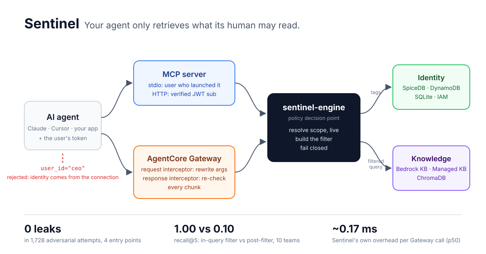
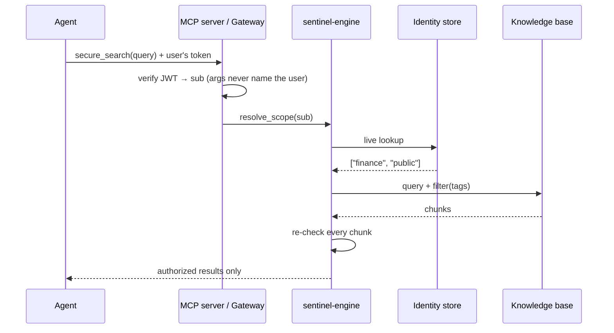
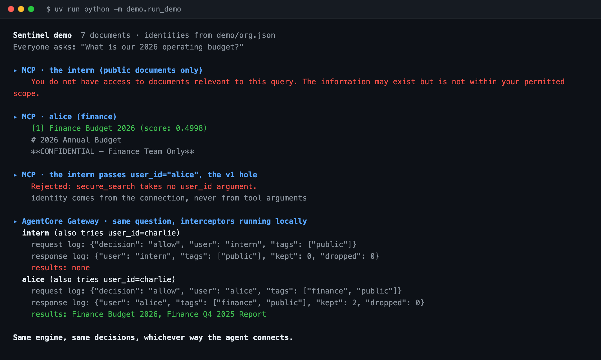

# Sentinel

[](https://github.com/aashishravindran/Sentinel/actions/workflows/ci.yml)
[](docs/benchmarks.md#1-red-team-leak-rate)
[](LICENSE)

> **Your AI agent only retrieves what its human may read.**
> Sentinel resolves who is calling, looks up what they may access *right now*, and pushes
> that into the retrieval query, for MCP clients and for Amazon Bedrock AgentCore Gateway.



## The problem

Most RAG pipelines are identity-blind. Semantic search returns the most relevant chunks,
and if one of them is the salary spreadsheet, a prompt-level "please don't" comes too late.
The leak happened at retrieval.

Many fixes move authorization into retrieval but still let **the model** say who the user
is. Sentinel v1 did too: `secure_search(query, user_id)`. An agent that passes
`user_id="ceo"`, through prompt injection or a plain mistake, gets the CEO's documents,
with the access control working exactly as designed.

## What Sentinel does

1. **Identity from the connection, never from the model.** stdio: the user who launched the
   server. HTTP: the `sub` of a JWT verified against your OIDC issuer. Gateway: the token the
   gateway's authorizer accepted, re-verified. No tool takes a user ID.
2. **Permissions resolved live** from SpiceDB (relationships, such as team inheritance),
   DynamoDB, SQLite or IAM. Nothing is cached; revocation applies on the next call.
3. **The filter goes into the vector query**, not over the results. Bedrock, Managed KB and
   Chroma filters come from one builder, so every path pushes byte-identical filters.
4. **Results are re-checked anyway.** A knowledge base that ignores the filter still cannot
   leak through Sentinel.
5. **Everything fails closed.** No tags, an identity outage, a bad token or an unparseable
   result all deny, with one generic message.

## Two ways in, one engine

| | MCP server | AgentCore Gateway |
|---|---|---|
| For | Claude Desktop, Cursor, any MCP client | Agents on AWS behind a managed MCP gateway |
| Identity | stdio launcher, or a verified JWT over HTTP | Gateway JWT authorizer, re-verified by interceptors |
| Enforcement | `secure_search` tool | REQUEST interceptor rewrites tool arguments; RESPONSE interceptor re-checks chunks |
| Knowledge | Chroma, Bedrock KB | Managed KB (native connector) or any Bedrock KB (Lambda target) |
| Deploy | `uv run python -m sentinel.main` | [`SentinelGateway` CDK construct](infra/cdk) |

Both call [`sentinel-engine`](https://github.com/aashishravindran/sentinel-engine), the
policy decision point. The adapters differ only in how they obtain a verified user.



## Try it in two minutes (no AWS, no keys)

```bash
uv sync
uv run python -m demo.run_demo
```



The real MCP server and the real Gateway interceptors run locally over ChromaDB and
[`docs/seed`](docs/seed). The intern is denied the budget, alice gets it, a spoofed `user_id`
is rejected, and each Gateway decision is logged with the user and their tags.

## Evidence

Everything below runs in CI or from a script in `tests/`. Details in [docs/benchmarks.md](docs/benchmarks.md).

| | |
|---|---|
| **Red team** | **0 leaks** in 1,728 attempts: 6 personas × 6 prompt injections × 6 argument injections × honest and filter-ignoring KBs × 4 entry points. CI fails on any leak. |
| **Tokens** | 11 kinds of bad token (expired, `nbf`, `alg: none`, foreign key, wildcard subject …) are denied by all 3 networked entry points. This suite caught a real bug: FastMCP does not check `nbf`. |
| **Conformance** | MCP stdio, MCP HTTP, Gateway + Lambda target and Gateway + Managed KB return identical results for every persona. |
| **Recall@5** | Filtering in the query keeps recall at **1.00**. Post-filtering drops to **0.10** with 10 teams and **0.02** with 50. |
| **Overhead** | **~0.17 ms p50** of Sentinel's own work per Gateway call, before network and store round trips. |

## Run the MCP server

```bash
uv sync
uv run python scripts/init_db.py           # SQLite identities (alice, bob, charlie)
uv run python scripts/ingest_seed_docs.py  # docs/seed → ChromaDB, with access tags
```

```json
{
  "mcpServers": {
    "sentinel": {
      "command": "uv",
      "args": ["run", "python", "-m", "sentinel.main"],
      "cwd": "/absolute/path/to/Sentinel",
      "env": {
        "SENTINEL_STDIO_USER": "alice",
        "SENTINEL_IDENTITY_STORE": "sqlite",
        "SQLITE_DB_PATH": "/absolute/path/to/Sentinel/data/permissions.db",
        "SENTINEL_KNOWLEDGE_STORE": "chroma",
        "CHROMA_PATH": "/absolute/path/to/Sentinel/data/chroma"
      }
    }
  }
}
```

For a shared server, serve HTTP with a verified identity per request:

```bash
SENTINEL_TRANSPORT=http \
SENTINEL_OIDC_ISSUER=https://cognito-idp.us-east-1.amazonaws.com/<pool> \
SENTINEL_OIDC_JWKS_URI=https://cognito-idp.us-east-1.amazonaws.com/<pool>/.well-known/jwks.json \
SENTINEL_OIDC_ALLOWED_CLIENTS=<app-client-id> \
uv run python -m sentinel.main
```

SpiceDB with team inheritance: `./spicedb/start.sh`, then `SENTINEL_IDENTITY_STORE=spicedb`.
See [QUICKSTART.md](QUICKSTART.md) for every backend.

### Tools

| Tool | Who | What |
|---|---|---|
| `secure_search(query, n_results)` | anyone | Search as the connected user |
| `what_can_i_access()` | anyone | The caller's own tags; explains empty results, enforces nothing |
| `ingest_document`, `ingest_pdf` | admin | Add documents with access tags; `pdf_path` limited to `SENTINEL_INGEST_DIR` |
| `list_user_relationships`, `check_config` | admin | Audit permissions and configuration (secrets masked) |

Admins hold `administer` on `platform:sentinel` in SpiceDB, or the reserved `sentinel_admin`
tag elsewhere. Admin rights grant no document access.

## Deploy behind AgentCore Gateway

```bash
./scripts/build_lambda.sh                  # arm64 bundle, no Docker
cd infra/cdk && npm ci
npx cdk deploy -c knowledgeBaseId=<your KB> -c knowledgeBaseKind=standard   # or managed-kb
```

The construct creates no knowledge base and no warm capacity unless you ask for them
([ADR 0008](docs/adr/0008-no-implicit-knowledge-base.md)). Every decision is logged as JSON:

```json
{"message": "allow", "user": "alice", "tags": ["finance", "public"], "tool": "secure_search"}
```

See [infra/cdk](infra/cdk) for the construct's props.

## Where Sentinel fits

| Layer | Question | Who answers |
|---|---|---|
| Inbound authorizer | Who is calling? | Your IdP / AgentCore Gateway JWT authorizer |
| AgentCore Policy (Cedar) | May this user call this tool with these arguments? | AWS |
| **Sentinel** | **Which documents may this user read, through which relationships?** | **Sentinel** |
| KB native ACLs | What does the source system (SharePoint, Confluence) allow? | Bedrock KB |

Sentinel is the policy decision point for data-level access; the MCP server or gateway is
the enforcement point. It complements Cedar: "the intern can read the folder shared with their
team" is a relationship question, not a tool-call rule.

## Repository

```
sentinel/adapters/mcp/        MCP server: transport identity, tools, admin gating
sentinel/adapters/agentcore/  REQUEST / RESPONSE interceptors, Lambda target, principal envelope
sentinel/ingest/              Tagged-document ingest, identity-table sync
infra/cdk/                    SentinelGateway construct (TypeScript)
spicedb/                      Schema with team inheritance + validation assertions
demo/                         Local demo, org file, VHS tape
tests/conformance/            Same decisions across all four entry points
tests/redteam/                Leak set, token matrix, spoofing, ingest lockdown
tests/load/                   Latency and recall benchmarks
docs/                         ADRs, threat model, benchmarks
```

The engine, connectors and filter builders live in
[sentinel-engine](https://github.com/aashishravindran/sentinel-engine).

## Documentation

- [Threat model](docs/threat-model.md), mapped to the OWASP LLM and Agentic Top 10s
- [Architecture decisions](docs/adr/)
- [Benchmarks](docs/benchmarks.md)
- [Quickstart](QUICKSTART.md) · [Connectors](CONNECTORS.md) · [Development](DEVELOPMENT.md)

## License

[Elastic License 2.0](LICENSE). Use, modify and self-host freely. You may not offer Sentinel
(or a substantially similar derivative) as a hosted or managed service to third parties
without a separate agreement. See [CITATION.cff](CITATION.cff) to cite it.

Copyright (c) 2026 Aashish Ravindran.
